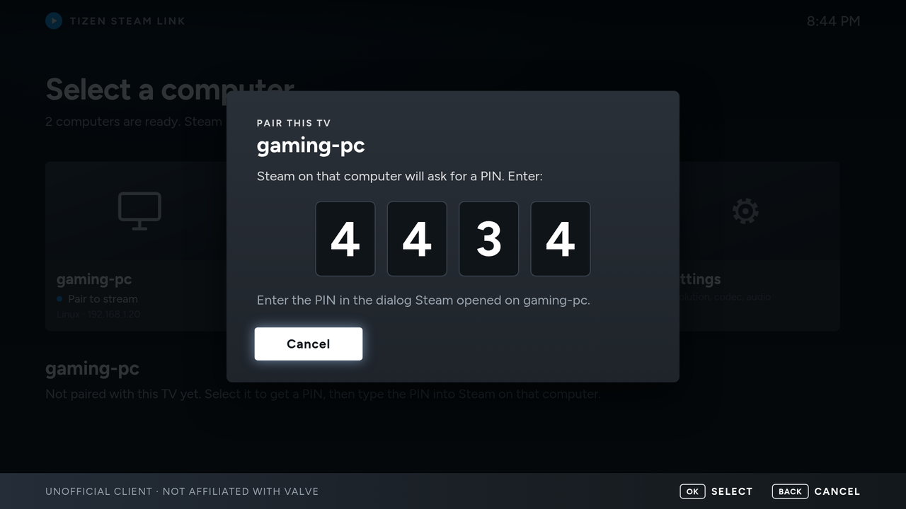

# Installing Tizen Steam Link

The app runs on Samsung TVs with Tizen 5.5 or later, which means 2020 models on. Samsung smart
monitors (M5, M7, M8 and the smart Odyssey models) run Tizen too, and Apps2Samsung lists them
as supported; the steps are the same if the monitor's Apps panel offers Developer Mode. Other
brands and plain monitors can't run it, since the app needs Tizen.

The app isn't in Samsung's store. You install it yourself, from a computer on the same
network, with the TV in Developer Mode.

## 1. Get the app package

Build it from this repository. You need Docker:

```sh
scripts/build-tizen.sh
```

The package lands in `out/TizenSteamLink.wgt`. The first build also sets up a toolchain image
of about 2 GB, which later builds reuse. [development.md](development.md) has the details.

## 2. Prepare the computer that runs Steam

Steam has to be running and logged in, with Remote Play turned on under Steam, Settings,
Remote Play.

If the computer runs a firewall, it has to let the TV in on UDP ports 27031 to 27036 and TCP
ports 27036 and 27037. With ufw on Linux, for a home network on 192.168.0.x:

```sh
sudo ufw allow from 192.168.0.0/24 to any port 27031:27036 proto udp
sudo ufw allow from 192.168.0.0/24 to any port 27036:27037 proto tcp
```

On a Linux desktop running Wayland (sway, for example), Steam started the usual way can't
capture the desktop. The stream then has sound and a black picture, and Steam's
`logs/streaming_log.txt` says "Desktop capture unavailable, try running Steam with -pipewire".
Steam's suggestion is to start it as `steam -pipewire`.

## 3. Turn on Developer Mode on the TV

1. Find the TV's IP address under Settings, Network, Network Status, IP Settings. The menu
   path differs a little between firmware versions.
2. Open Apps from the home screen and type `1 2 3 4 5` with the remote. On remotes without
   number keys, bring up the on-screen keypad first (the 123 button).
3. Switch Developer mode on, and enter the IP address of the computer you will install from.
4. Restart the TV fully: hold the power button until it switches off and comes back on. A
   short press only puts it in standby, and the setting doesn't take effect.
5. The Apps screen now says Developer Mode at the top.

## 4. Install with Apps2Samsung

1. Install [Apps2Samsung](https://github.com/Apps2Samsung/Apps2Samsung) on the computer you
   named in step 3. On Arch Linux it's `apps2samsung` in the AUR; there is also an AppImage.
2. Start it. It finds the TV on the network, or you type in the TV's IP address.
3. Keep the default certificate. TVs on Tizen 7 or later only run apps signed for that TV, so
   Apps2Samsung asks you to sign in with a Samsung account and signs the package for you.
4. Pick "Custom WGT File", choose `out/TizenSteamLink.wgt`, then install it.
5. Tizen Steam Link shows up under Apps.

To update the app later, build the new package and install it the same way.

## 5. Pair and stream

Open Tizen Steam Link. Computers running Steam on the network show up by themselves. If yours
doesn't, use Other computer and type its IP address.

Select the computer. The TV shows a four-digit PIN, and Steam opens a dialog on the computer
that asks for it. Type it there, then select the computer again to stream.



The TV is paired with that computer from then on. Each computer needs its own pairing.

## If something goes wrong

| What you see | What to do |
|---|---|
| Apps2Samsung doesn't find the TV | Check that Developer Mode is on (the Apps screen says so) and that you entered this computer's IP address in step 3. Typing the TV's IP address in Apps2Samsung also works. |
| The install fails on a newer TV | Tizen 7 and later need the Samsung account sign-in in step 4.3, so the package gets signed for that TV. |
| The computer doesn't show up in the app | Check the firewall rules in step 2, that both are on the same network, and that Steam is running. Other computer, with the IP address, works when the network blocks discovery. |
| "This device is not paired with the host" | Steam forgot the TV. The tile shows Pair to stream again; pair once more. |
| The app stops opening after a TV firmware update | The update turned Developer Mode off. Repeat step 3 and reinstall (step 4). |
| The app opens but something else is wrong | Press the blue key for the app's log. [development.md](development.md#debugging-on-the-tv) explains how to attach Chrome's inspector to the app. |
